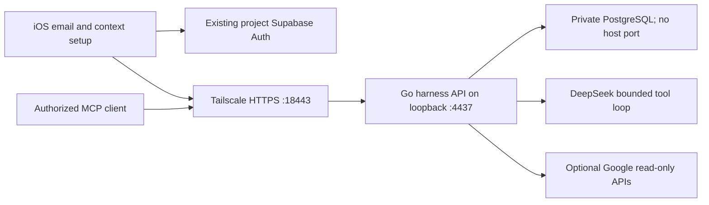

# DeepSeek account and context harness

Status: implementation and live acceptance in progress, 2026-10-24.

## User stories

1. After the existing terms consent, a new traveler sees an email entry. They can verify an email code, sign in to an existing account with a password, or continue locally. Entering an address alone never authenticates them.
2. A verified traveler can separately choose read-only Google Calendar and Gmail access or skip Google. Missing provider configuration, denial, cancellation and expiry remain visible recoverable states.
3. They can review and edit their name, home city and interests. The address never becomes evidence of a name, location, occupation or personality. Imported records retain provenance; model suggestions are not silently saved as facts.
4. Explicit separate consent permits selected account context to reach DeepSeek. Without this consent, model requests cannot read calendar or mail. A traveler can revoke Google access and clear model-context consent from account settings.
5. The native account page invokes the stateless server DeepSeek loop; the same bounded read tools are available through authenticated MCP. Unavailable or unauthorized sources return a clear error, never an invented empty result. Private profile/provider context is not injected into the existing device-local conversation journal: that journal has no account ownership boundary. Suggestions stay in the account page's transient state and are discarded when it closes or signs out.

## Architecture

Reuse the existing Go API and Supabase email identity provider. Store the harness
email session in its own Keychain account: legacy anonymous sync bootstrap cannot
replace it, and legacy device-local/outbox data is not migrated into a new email
account. The account setup authorizes private context/provider tools. Add a private PostgreSQL
schema for this harness, with encrypted provider tokens. Do not reuse another
application's database, OAuth credentials, users or Tailscale handler.

Proposed origin: `https://smile-m4-minimac-mini.tail25e61f.ts.net:18443`.
This is an internal testing endpoint, not evidence of public hosting or physical
device acceptance. Never reset Tailscale Serve or replace existing handlers.

## Frozen wire contract

All routes are below `/v1/harness` except `/mcp`. JSON uses snake_case. Protected
routes require the existing project's Supabase bearer token, verified using
`GET /auth/v1/user`; anonymous or unverified-email identities are rejected. Never
trust a client-supplied user ID or user-editable metadata for authorization.

| Method / path          | Contract                                                                                                                                                                                    |
| ---------------------- | ------------------------------------------------------------------------------------------------------------------------------------------------------------------------------------------- |
| GET `/capabilities`    | `{email_auth,google,deepseek,database}` booleans; no credentials                                                                                                                            |
| GET `/profile`         | `{user_id,email,display_name,home_city,interests,ai_context_consent,google:{connected,email,scopes}}`                                                                                       |
| PUT `/profile`         | Accept only `{display_name,home_city,interests,ai_context_consent}`; return profile. Email/ID come from verified auth. Full replacement of these editable fields.                           |
| POST `/google/start`   | `{calendar,mail}` booleans, at least one true → `{authorization_url,expires_at}`; 503 when unconfigured                                                                                     |
| GET `/google/callback` | One-use expiring state and PKCE; encrypted tokens; redirect to `solocompass://google-connected?status=connected` or `status=error`, with no tokens or personal data in the URL              |
| DELETE `/google`       | Erase local tokens/access immediately, attempt provider revocation; return `{disconnected,provider_revocation_confirmed}` honestly                                                          |
| GET `/context`         | Confirmed/manual context and provenance, no raw mail or tokens                                                                                                                              |
| POST `/tools/call`     | `{name,arguments}`; identical authenticated registry as MCP; Google data requires provider scopes and separate model-context consent                                                        |
| POST `/chat`           | `{message}` → `{reply,tool_calls:[{name,status}],sources:[]}`; max 4 model rounds / 6 calls; server-owned `deepseek-flash`, `thinking:{type:"disabled"}`                                    |
| POST `/mcp`            | MCP stateless Streamable HTTP JSON: initialize, ping, tools/list, tools/call; accept notifications with HTTP 202. GET returns 405 if no SSE. Validate Origin against the configured origin. |

Read tools: `get_traveler_profile` (only confirmed/manual fields, no email),
`list_calendar_events` (primary calendar; at most 20 events over next 14 days),
`search_travel_mail` (at most 10 travel-related messages from the last 30 days;
selected headers and snippets only, no bodies or attachments). Tool arguments
cannot select a different user, arbitrary endpoint, date window or mailbox.
No send, booking, calendar mutation, shell or arbitrary remote MCP tools.

Only caller-authorized context may reach DeepSeek. Treat all provider text as
untrusted evidence, never tool instructions. Traces contain tool names/status
only. Never log request bodies, auth codes, tokens, email contents or prompts.
Apply bounded HTTP timeouts/body sizes, input validation, parameterized SQL and
rate limits to paid operations. Provider errors are sanitized.

## Acceptance

- Focused native tests: email validation, verification failure, session restore,
  account switch/sign-out, optional Google skip/denial, URL validation, consent.
- Focused API tests: invalid/anonymous identity, owner isolation, OAuth state
  replay/expiry, scope/consent denial, encryption, MCP Origin and malformed RPC,
  bounded tool execution and provider failure.
- A real private database migration and readiness query; no published DB port.
- Loopback and exact Tailscale HTTPS readiness, authenticated profile round trip,
  unauthorized MCP rejection and a real bounded DeepSeek tool invocation.
- One `primary` shared iOS session: build, affected tests, fresh onboarding,
  skip Google and account settings; screenshots and receipts. Preserve existing
  simulator data and do not erase it. No physical-device or real Google OAuth
  success claim until separately observed.

## Sources

- Supabase email OTP and email-template requirement: https://supabase.com/docs/reference/swift/auth-signinwithotp
- Supabase Auth REST endpoints: https://github.com/supabase/auth/blob/master/README.md
- Google server authorization: https://developers.google.com/identity/protocols/oauth2/web-server
- Gmail least-privilege scopes: https://developers.google.com/workspace/gmail/api/auth/scopes
- Calendar scopes: https://developers.google.com/workspace/calendar/api/auth
- DeepSeek tool loop: https://api-docs.deepseek.com/guides/tool_calls/
- MCP transport and Origin requirements: https://modelcontextprotocol.io/specification/2025-11-25/basic/transports
- Native OAuth browser session: https://developer.apple.com/documentation/authenticationservices/aswebauthenticationsession
