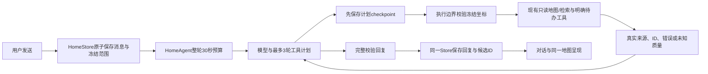

# V4 原生落地与验收

实现提交：`4278f74a`。当前默认入口 `CompanionHomeView` 已接入 V4，该提交已通过SDK App编译与132项重点原生测试；完整CI的唯一失败是公共API文档检测，正在补齐门禁与原生UI交互验收。V4 HTML原型与14秒状态片仍是设计资料，不能代替这里的原生证据。

## 实现范围

- 底部固定对话、地图、行程、我的；对话默认打开，输入框与导航分开，系统键盘出现时让出底栏空间。地图首次访问再加载，之后保持同一原生Map与模型，避免冷启动先拉地图。
- 回复保存真实候选ID组。点某条回答的地点进入同一地图，来源、阅读锚点和草稿保留；选点后「聊聊这里」只设置下一问范围，不创建另一份会话。地图切换附近/收藏、类别与区域不改历史回答或已确认行程。
- 草稿、附件、引用、一次地点/区域scope、稳定会话ID与阅读状态沿用既有本地原子快照；旧v1资料兼容读取。滚动只更新内存，切tab/后台才flush。旧消息阅读期间回复到达会保留锚点并记录未读。
- 收藏沿用UserPreferences唯一数据源。当前区域支持手动视区与无GPS；全部收藏不受视区裁剪。OSM网格资料使用25km当前区域回退，不把它称为行政城市边界。取消最后一项会清选点。
- 明确query搜索锁定本次真实ID，空结果保持空，失败与无匹配分开，取消/晚到结果不覆盖新范围。普通本地分类不自动发模型请求。查询另一区域时不把旅程城市写成结果所在地。
- 行程复用已有ItineraryListView；我的复用MeSheet并保留当前Companion快照的导出/清理接线。现有媒体、同行人、约定和路线入口保留。

## AI 链路与提速

地点/区域scope只作用一次；省略坐标的工具请求会补入该消息冻结范围，非法或冲突坐标不会下发。普通闲聊只获得用户已选公共城市中心，不会把缓存GPS或精确视口自动送进模型。精确地图信息只来自明确的本次地点/区域提问。

取消会传到底层SSE/MKLocalSearch；共享校准的单个等待者可立即退出，其他请求仍能使用共享结果。流式401/429/5xx、超时、取消和半截输出不再自动重发完整请求；只有明确不支持流式的兼容情况才回退一次。当前默认HomeAgent仍完整校验非流式最终回复，避免为了首字提前展示未核实JSON。

这里没有把写地图、收藏toggle、行程变更盲目并行；共享状态通过单一Store与工具journal排序。开发时的多个subagent负责不同文件与场景审查，不各自维护一份旅行事实。

## 验证分层

| 证据                    | 已有结果                                                     | 边界                                                                |
| ----------------------- | ------------------------------------------------------------ | ------------------------------------------------------------------- |
| Store连续性宿主         | 27项通过，另补1项持久未读重载回归                            | 实际Store/Models，平台媒体与外部Agent有stub                         |
| AI transport宿主        | 10项通过                                                     | 真实URLSession/URLProtocol与生产SSE代码；业务请求构建隔离           |
| Agent/Store执行归属宿主 | 12项通过，冻结坐标断言先4红后绿                              | 真实Store/Models/Media/Agent、磁盘journal，模型与router执行边界stub |
| 校准等待取消            | 挂起probe先红，修后0.031秒通过；原共享成功回归保留           | 真实Mac SDK编译，非iOS界面                                          |
| 4278原生重点XCTest      | 17个相关类132项通过，0失败0跳过                              | 包含地图21项、取消2项与真实Store/Agent/transport；未覆盖真机        |
| 真实模型/provider       | [4个官方模型请求与原始结果](real-tools-eval.md)              | 模型成功不等于找到地点；没有虚构happy path                          |
| 后端Web检索             | [1次Auth返回400 invalid_credentials](backend-search-eval.md) | 无会话，Edge查询0次；GET-335跟踪，不能判断Edge/provider健康         |
| 新原生UI                | [V4NavigationUITests.swift](V4NavigationUITests.swift)       | 未取得结果前不声称通过；原生全选失败不得破坏原草稿                  |

`4278f74a`已通过SDK编译。完整单元测试执行2,066项，其中14项是既有跳过，唯一失败为4个新公开声明缺少文档注释；补充后，原检测器宿主复跑2/2通过。CI保留全部门禁并将job预算提高至45分钟，分别运行账号和V4交互验收。后续修复提交必须读取自己的CI结果。

V4 UI验收使用CI临时Simulator中的公开种子地点与明确标记的本地会话fixture，覆盖四栏、未发送草稿、来源地点→地图→收藏→一次scope→原阅读位置。它不调用模型，不冒充真实搜索结果。fixture写入器拒绝开发机和非空真实会话；截图与simctl录屏来自原生App。未获得UI结果前不声称通过。

## 尚待记录

- 最终修复提交对应的SDK编译、完整XCTest、UI截图/视频和当前head CI结果。
- 当前Apple公开查询样本未获得候选，不能解释为东京没有书店；附加bundle/AppKit与regionPriority诊断也未改变本机样本。不能用宿主失败推导iOS必然失败。
- 预订、支付、改签与取消的执行层未由本轮UI补齐；行程仍由现有存储与明确确认维护。没有真机、全体用户成功率或p95验收结论。

## 原生运行后的修复

2668dd8c 已通过 App 编译、2,068 项单元执行（14 项既有跳过、0 失败）与 3 项账号 UI。V4 原生用例中，四栏/草稿通过；来源跳图失败，实际截图显示地点已选中、面板仍为 86pt 折叠态。消息 reveal 现在在配置完成、激活和 token 变化时统一消费，只处理激活后的新 token；普通 tab 重访保留用户的折叠选择。地点卡把「聊聊这里 / 收藏」前置，原生完整流程仍以修复提交的 CI 为准。

并行场景 Eval 复现了连续改搜索词时旧忙碌 guard 吞掉新提交的问题。修复后先取消旧请求、等它清理，再执行最新词；切模式/视区时保留任务句柄以便等待取消。真实 caller 的宿主提取测试观察到旧逻辑失败、修后 7 项通过；消息消费函数另有 12 项通过。UIKit、VM、transport 和 callback 投递有明确 stub，不能替代原生面板验收。可复跑脚本为 `scripts/qa/v4-map-query-host.py`，两种场景已加入 macOS CI。

原始 simctl H.264 录像保留；`scripts/qa/export-v4-preview.swift` 仅对真实录像压缩为长边不超过 1280 的预览（最长末尾 90 秒），没有重绘界面。实际原生素材的方向、比例、首尾解码和快速起播已单独验证；故障录像仍明确作为诊断证据。
